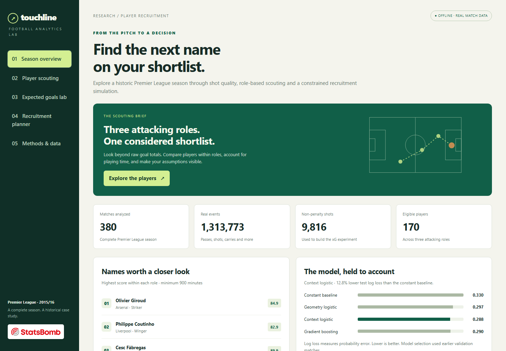
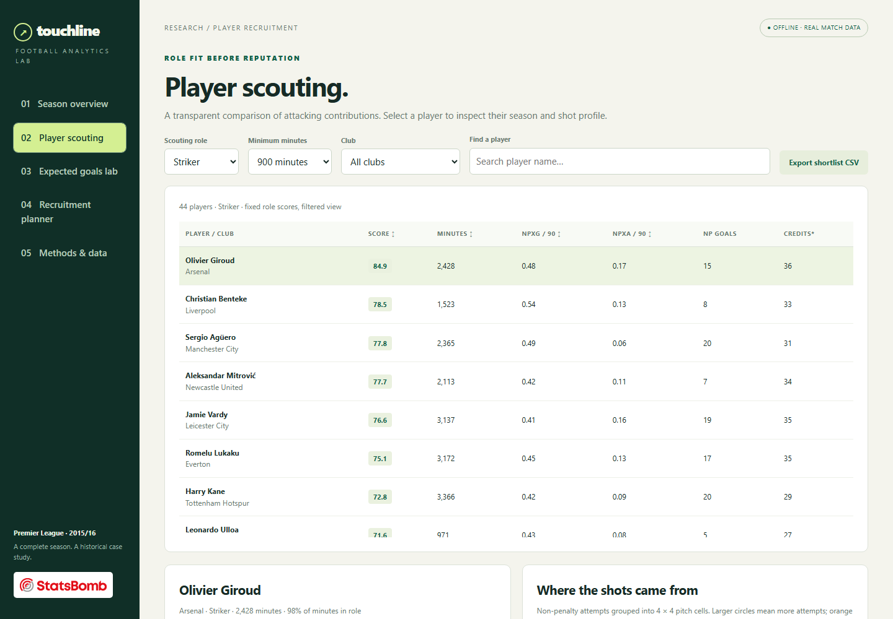
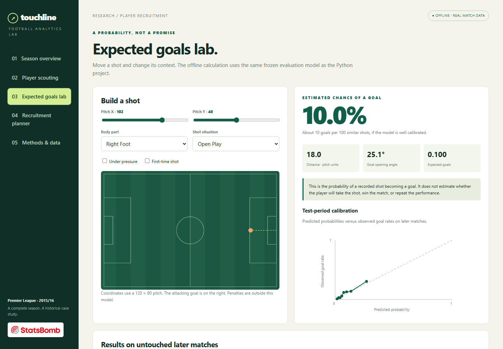

# Touchline: Football Scouting, xG and Recruitment Optimization

[](https://github.com/JVAISAG/Football-Scouting/actions/workflows/analytics.yml)
[](https://github.com/JVAISAG/Football-Scouting/actions/workflows/pages.yml)

**[Open the live dashboard](https://jvaisag.github.io/Football-Scouting/)** · [Findings](reports/FINDINGS.md) · [Independent-season results](reports/EXTERNAL_VALIDATION.md) · [Testing guide](docs/TESTING.md)

An end-to-end football analytics case study: **1.31 million real events**, an original xG model, role-based scouting and exact recruitment optimization.



<p>
  <a href="docs/images/dashboard-scouting.png"></a>
  <a href="docs/images/dashboard-xg.png"></a>
</p>

| Evaluation | Matches | Non-penalty shots | Model log loss | Frozen baseline log loss |
|---|---:|---:|---:|---:|
| EPL 2015/16 chronological holdout | 60 | 1,629 | 0.2878 | 0.3299 |
| **Independent ISL 2021/22 season** | **115** | **3,046** | **0.2985** | **0.3334** |

The frozen EPL model achieved **10.5% lower log loss** than its frozen baseline on the independent season, without retraining or recalibration. This is evidence of transfer on another season **and league**; it does not establish second-season Premier League performance or future player-ranking accuracy. [Protocol, calibration and limitations →](reports/EXTERNAL_VALIDATION.md)

---

A reproducible data analytics portfolio project using real StatsBomb events from the complete **2015/16 Premier League season (380 matches)**. It combines Python, SQL, probability modeling, statistical analysis and a constrained recruitment simulation.

**Measured scope:** 1,313,773 source events, 9,816 non-penalty shots, 170 eligible attacking players. The selected model achieved 12.8% lower held-out test log loss than the constant baseline.

**Start here:** [open the live demo](https://jvaisag.github.io/Football-Scouting/) or open `dashboard.html` in Edge, Chrome or Firefox. It is a self-contained offline file. No installation, server or API key is needed to explore it.

Then read `reports/FINDINGS.md`, `reports/METHODOLOGY.md` and `reports/INTERVIEW_GUIDE.md`.

## The business problem

An analyst supporting a football club must shortlist attacking players for video review and demonstrate how priorities change under a limited budget. The project delivers:

1. A source-verified, restartable data pipeline and a SQLite warehouse.
2. An original non-penalty expected-goals model evaluated on later matches.
3. Player metrics per 90 minutes, role eligibility and transparent scoring.
4. An exact three-player recruitment optimizer: one striker, one winger and one creator, with budget and club constraints.
5. An interactive offline dashboard with a portable copy of the trained evaluation model.
6. SQL analyses, statistical checks, tests, findings and interview notes.

This is a **historical analytical case study**. Recruitment costs are hypothetical credits. The selection is an attacking recruitment unit, not a full XI or a real transfer recommendation.

## What is included

- `dashboard.html`: the ready-to-use offline dashboard.
- `src/`: downloader, event normalization, model training, scouting, optimization, publishing and single-shot prediction.
- `sql/analysis.sql`: 14 named analyses covering joins, CTEs, conditional aggregation, window functions and data checks.
- `reports/`: findings, methodology, model results, statistical analysis, minutes audit, charts and interview notes.
- `models/`: frozen evaluation model, retrospective scouting refit, model card and portable browser model.
- `data/source/`: pinned revision and download manifest with SHA-256 hashes; source agreement and attribution.
- `data/processed/`: aggregate analytical outputs. The local working project also contains the event warehouse and shot tables.
- `tests/`: unit and data acceptance tests.

The ZIP is a **code-and-analysis package**. It includes the working dashboard, trained models and aggregate results. It excludes original source files, row-level event/shot data and the large local database. The downloader reconstructs the pinned source snapshot. Keep raw files and the local database out of a public GitHub repository; retain StatsBomb attribution and review the included source agreement before publishing.

## Reproduce the full analysis

Use **Python 3.12** for the recorded dependency lock. In a terminal opened in this project folder:

```powershell
py -3.12 -m venv .venv
.\.venv\Scripts\python.exe -m pip install -r requirements.txt
.\.venv\Scripts\python.exe src/run_pipeline.py --download --rebuild-raw
.\.venv\Scripts\python.exe src/external_validation.py --download
.\.venv\Scripts\python.exe sql/run_queries.py
.\.venv\Scripts\python.exe -m pytest tests/unit tests/artifacts tests/integration tests/external -q
```

The first run needs internet access and sufficient disk space for downloaded event files and the database. Downloads are cached as gzip files in `data/raw/`; rerunning resumes verified files. SHA-256 source hashes are recorded in `data/source/manifest.csv`. The pinned commit is in `data/source/revision.json`. Do not change it if reproducing these results.

If the local database already exists, rerun modeling and reports without downloading:

```powershell
.\.venv\Scripts\python.exe src/run_pipeline.py
```

To use a raw cache elsewhere:

```powershell
.\.venv\Scripts\python.exe src/run_pipeline.py --download --rebuild-raw --cache-dir C:\path\to\cache
```

On macOS/Linux, use `python3 -m venv .venv` and `.venv/bin/python` instead of the Windows executable path.

## Predict a shot

```powershell
.\.venv\Scripts\python.exe src/predict_shot.py --x 108 --y 40 --body-part "Right Foot"
```

Coordinates use the StatsBomb **120 × 80 normalized pitch**, with the attacking goal at X=120, Y=40. They are not metres. The CLI and dashboard use the frozen evaluation model, exclude penalties and do not estimate pre-match results.

## Use the dashboard

- **Season overview:** data coverage, role leaders, model comparison and computed standings.
- **Player scouting:** filter role, club, minutes and name; sort metrics; inspect player profiles; export the current shortlist as CSV.
- **Expected goals lab:** change shot location, body part, situation, pressure and first-time status; view exact offline model predictions and test calibration.
- **Recruitment planner:** adjust the budget, find the globally optimal eligible three-player combination, and inspect infeasible scenarios.
- **Methods & data:** metric definitions, assumptions, evaluation choices and limitations.

Filters change the displayed pool; they do not recalculate global role percentiles. Player costs and scores remain fixed across budget scenarios.

## Important analytical distinctions

**Evaluation:** training dates come first, validation dates next, and test dates last. Entire matches and dates stay together. Select the model on validation log loss, refit on training plus validation, then evaluate on test. A training-plus-validation constant conversion-rate baseline is included.

**Retrospective scouting:** after evaluation, a separate copy is refitted on all season shots to describe shot quality for historical player comparisons. Those xG values are in-sample. Scouting rankings are not validated predictions of next-season player performance.

**Minutes:** reconstructed from ordered starting lineups, substitutions, tactical shifts, red cards and permanent departures. Each half is capped at 45 regulation minutes. Stoppage-time event counts are retained. Differences from supplied lineup intervals are recorded in `reports/minutes_audit.csv`.

**Budget:** synthetic credits partly depend on retrospective scores. Optimization demonstrates the ability to apply constraints, not the discovery of undervalued transfer targets.

## Data credit

Data and official logo: **StatsBomb Open Data** — https://github.com/statsbomb/open-data (now redirects to the provider's Hudl repository). This project is independent research and is not endorsed by StatsBomb, Hudl, the Premier League or any club. Keep the source agreement in `data/source/LICENSE.pdf` and the attribution/logo when sharing analysis. GitHub Pages publishes the self-contained dashboard through the documented deployment workflow.

## Automated checks and explicit test scope

GitHub Actions runs unit/artifact checks, a full 380-match rebuild, independent-season evaluation, and offline browser checks. **Missing warehouse or external data fails the corresponding suite; it never silently skips.**

```bash
# Fast checks: synthetic inputs plus committed analytical outputs
python -m pytest tests/unit tests/artifacts -q

# Full data: first rebuild the warehouse
python src/run_pipeline.py --download --rebuild-raw
python -m pytest tests/integration -q

# Independent season: use the frozen model without refitting
python src/external_validation.py --download
python -m pytest tests/external -q
```

A plain `python -m pytest` intentionally selects only the unit and committed-artifact suites. It is not a claim that the full warehouse was rebuilt. [Detailed suite contracts and CI behavior →](docs/TESTING.md)

## Live demo deployment

GitHub Pages publishes only the self-contained dashboard, built by `python src/build_site.py`. The Pages workflow never uploads the repository, raw events or warehouse as a website. The demo URL is `https://jvaisag.github.io/Football-Scouting/`.

The Pages source must be set to **GitHub Actions** in repository settings. Successful deployments appear in the `github-pages` environment and [deployment workflow](https://github.com/JVAISAG/Football-Scouting/actions/workflows/pages.yml).

## Additional validation

`role_weight_sensitivity.csv` compares the base role weights with creation-priority and progression-priority alternatives, reporting top-five overlap. `reports/VALIDATION.md` records the checks actually completed.

Optional browser automation: install Playwright in a separate development environment, run `python src/browser_fixtures.py`, then `node tests/browser_smoke.cjs`. It needs an installed Edge browser by default; set `TOUCHLINE_BROWSER` to a Chromium executable, or `TOUCHLINE_USE_BUNDLED=1` to use Playwright Chromium. The core Python analysis does not require Node.
