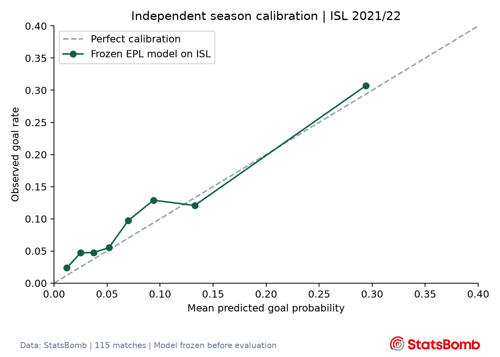

# Independent later-season evaluation


The frozen **Context logistic** model, trained on EPL shots through 2016-04-09, was evaluated without retraining or recalibration on the complete **Indian Super League 2021/22 season**.

- Matches: **115**, including 110 regular-season matches and five playoff matches; all 11 clubs have 20 regular-season games.
- Dates: 2021-11-19 to 2022-03-20.
- Real source events: **344,667**.
- Valid non-penalty shots in regulation time: **3,046**.
- Model test log loss: **0.2985**.
- Frozen EPL baseline log loss: **0.3334**.
- Relative log-loss improvement: **10.5%**.
- Brier score: **0.0835**; ROC AUC: **0.729**.
- Mean predicted probability: 0.090; observed goal rate: 0.103.
- Match-bootstrap 95% interval for baseline minus model log loss: **0.0226 to 0.0461** (1,000 replicates, seed 42).



## Protocol and interpretation

No external outcomes were used to train, select or recalibrate this model. The baseline is frozen at the original EPL training-plus-validation goal rate (0.09124), rather than estimated from the external season. Source files are pinned to the same commit and have a SHA-256 manifest. The frozen model hash is `e607de4e223458a64206a014feb26dcd087ae49382b9515d1a445e6fce5fe69f`.

One later season in a different league. This tests temporal plus competition transfer; it does not establish second-season Premier League performance, calibration in every league, or future player-ranking validity.

A positive model-versus-baseline result supports transfer on this particular sample; inspect calibration and uncertainty before claiming more. The player-role scores and recruitment optimizer are still descriptive EPL analyses and are not validated by this shot-model experiment.

Excluded shots: {'penalty': 34, 'extra_time_or_shootout': 15, 'invalid_location': 0}. Penalty shootouts and extra time are excluded consistently with the original experiment. Data: [StatsBomb Open Data](https://github.com/statsbomb/open-data). Retain the StatsBomb credit and official logo when sharing analysis.

## Reproduce

```bash
python src/external_validation.py --download
python -m pytest tests/external -q
```

Cached downloads and per-shot predictions remain in ignored `data/external/`. Aggregate metrics, calibration and source hashes are committed. Repeating evaluation never refits the model.
